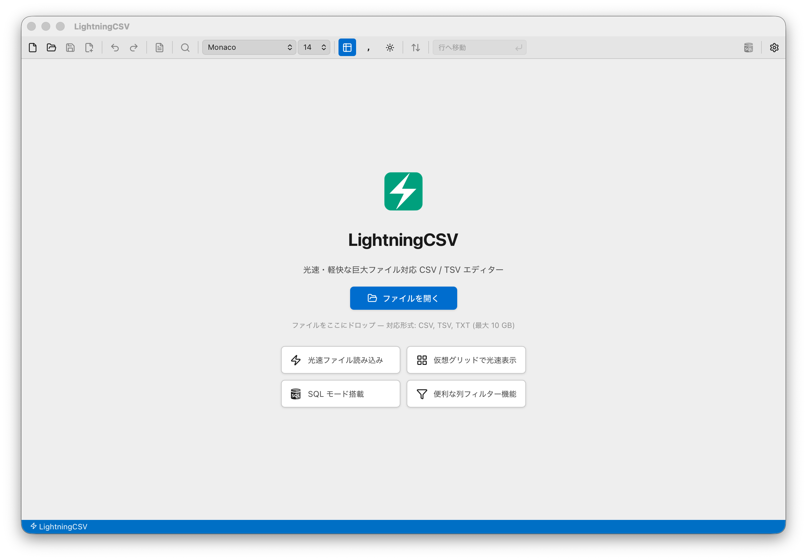
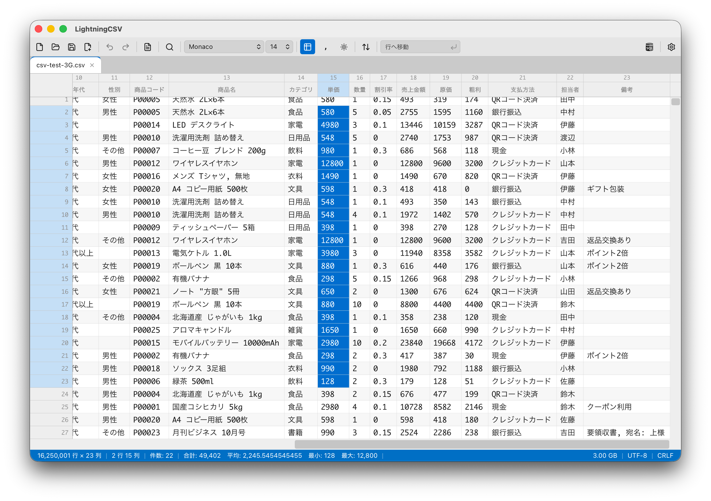
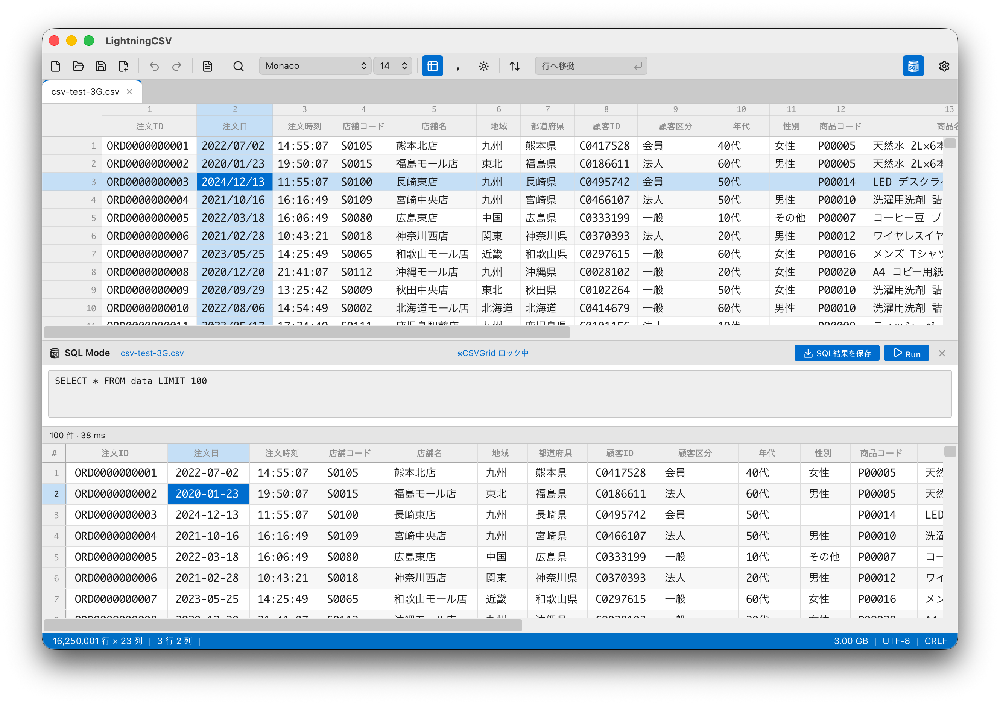

# LightningCSV

<p align="center">
  
</p>

**巨大 CSV ファイルも一瞬で開ける、Windows / macOS 向け高速 CSV / テキストエディター**

10 GB 超のファイルもストレスなく閲覧・編集・検索・集計できます。

---

<p align="center">
  
</p>

<p align="center">
  
</p>

<p align="center">
  
</p>

## ダウンロード・インストール

[Releases ページ](https://github.com/Ore2Mon2/LightningCSV/releases) から最新版をダウンロードしてください。
Windows 版はコード署名済み、macOS 版は Developer ID 署名と Apple の公証（ノータリゼーション）済みです。

| ファイル | 説明 |
|---------|------|
| `LightningCSV_x.x.x_windows_portable.zip` | **Windows ポータブル版** — インストール不要。zip を展開して `LightningCSV.exe` を実行するだけで使えます |
| `LightningCSV_x.x.x_macos_arm64.dmg` | **macOS 版**（Apple Silicon）— dmg を開き、`LightningCSV` を「アプリケーション」フォルダへドラッグしてください |

### 動作環境

- **Windows 11**（64 ビット）
  - WebView2 ランタイム（Windows 11 には標準搭載）
- **macOS 11 Big Sur 以降**（Apple Silicon の Mac。macOS 26 で動作確認）

---

## 主な特徴

- **巨大ファイルでも一瞬で開く** — 10 GB のファイルも 1 秒以内に表示
- **100 万行超でもサクサクスクロール** — 必要な部分だけ読み込む仮想スクロール
- **メモリに優しい** — ファイル全体をメモリに読み込まないため、PC のメモリが少なくても大丈夫
- **SQL でデータ分析** — SELECT / WHERE / GROUP BY など、SQL クエリでデータの検索・集計が可能
- **文字コード自動判定** — UTF-8 / Shift_JIS を自動検出（手動切替も可能）
- **ダークモード対応** — ライト / ダーク / システム連動テーマ
- **日本語 / 英語 対応** — 設定から切り替え可能

---

## 機能一覧

### ファイル操作

- CSV / TSV / TXT / LOG など、テキスト形式のファイルを開ける
- ファイルダイアログ、または**ドラッグ＆ドロップ**で開く
- **新規作成**（5 行 × 5 列の空の表から作成）
- **複数ファイルをタブで同時に開ける**
- `.csv` / `.tsv` ファイルの関連付けに対応（ダブルクリックや「プログラムから開く」で LightningCSV が起動）
- 起動中に別のファイルを開くと、新しいウィンドウではなく既存のウィンドウにタブとして追加
- 上書き保存 / 名前を付けて保存に対応
- タブを閉じるとき・アプリを終了するときに、未保存の変更があれば確認ダイアログを表示
- ウィンドウの位置と大きさを記憶し、次回起動時に復元

### CSV グリッド表示

- **表計算ソフトのような見た目**で CSV データを閲覧・編集
- セルをダブルクリック or F2 キーで編集開始
- 行・列の**挿入・削除**が可能
- セル・範囲・行・列の選択、選択範囲のコピー（Excel などに貼り付けられるタブ区切り形式）
- **指定行へジャンプ** — ツールバーの行番号欄に行番号を入力して Enter
- 複数セルを選択すると、ステータスバーに**件数・合計・平均・最小・最大**を表示（列全体など大きな範囲も全件を集計）
- 列幅をドラッグで調整可能
- 右クリックのコンテキストメニューからもコピー・ペースト・行列操作が可能

### テキスト表示

- ツールバーの切替ボタンで、グリッド表示と**テキストモード**を切り替えられる（ログファイルなど、表形式でないファイルの閲覧に）
- 行番号付きで見やすく表示
- 大きなファイルもページ単位で快適に閲覧

### 検索・置換

- **Ctrl+F** で検索パネルを表示
- **Ctrl+H**（macOS は **⌥⌘F**）で置換モードを表示
- 通常のテキスト検索と**正規表現検索**に対応
- 大文字・小文字の区別 ON/OFF
- Enter / Shift+Enter で次 / 前の検索結果に移動
- 一括置換にも対応

### 列フィルター

- 各列のヘッダーから**フィルターをかけて絞り込み**が可能
- **値の一覧から選択**してフィルター（Excel のオートフィルターのように使える）
- **条件指定フィルター** — 「〜を含む」「〜で始まる」「〜より大きい」など多彩な条件
- 複数列のフィルターを同時に適用可能（AND 条件）
- 絞り込んだ行（または絞り込まれなかった行）の一括削除
- フィルター結果だけを別ファイルに保存することも可能

### 並べ替え（ソート）

- **複数列を優先順位付き**で並べ替え可能
- 昇順 / 降順、数値順 / 文字列順 / 日付順 / 文字列長順
- 空白セル（NULL）の位置を先頭 / 末尾に指定可能
- **選択範囲だけを並べ替え**ることも可能
- ドラッグ＆ドロップでソート条件の優先順位を変更

### SQL 検索・集計

- **Ctrl+Shift+S** で SQL パネルを表示
- 開いている CSV を `data` というテーブル名で参照し、SQL クエリを実行
  ```sql
  SELECT 都道府県, COUNT(*) AS 件数
  FROM data
  WHERE 金額 > 10000
  GROUP BY 都道府県
  ORDER BY 件数 DESC
  ```
- 何百万行の結果でもスクロールして閲覧でき、結果をコピー可能
- 集計結果を CSV / TSV などのファイルとして保存可能
- Shift_JIS のファイルにも対応

### 編集・Undo/Redo

- セルの編集、行・列の追加・挿入・削除が可能
- **Ctrl+Z** で元に戻す、**Ctrl+Y** でやり直し
- 元に戻せる回数は設定で変更可能（10〜100 回、デフォルト 100 回）

### 保存オプション

- フィルター結果・SQL 結果を保存するときに以下を選択可能（前回選んだ内容を記憶）:
  - **拡張子**（.csv / .tsv / .txt）
  - **区切り文字**（カンマ / タブ / セミコロン / パイプ / スペース）
  - **文字コード**（UTF-8 / UTF-8 BOM 付き / Shift_JIS / UTF-16 LE）
  - **改行コード**（CRLF / LF）
  - **クォート文字** / **ヘッダー行の有無** / **NULL の表現**

### 設定

- **Ctrl+,**（macOS は **⌘,**）で設定ダイアログを表示
- 表示言語（日本語 / 英語）・テーマ（ライト / ダーク / システム連動）
- フォント・フォントサイズ・行の高さをカスタマイズ
- 先頭行をヘッダーとして扱うかどうかの切替
- デフォルトの区切り文字・文字コード・改行コードの設定
- 起動時に新しいバージョンがあるかを確認し、あればお知らせ（自動更新は行いません）

---

## キーボードショートカット

macOS では `Ctrl` の代わりに `⌘`（Command）キーを使います。

| 操作 | Windows | macOS |
|------|---------|-------|
| ファイルを開く | `Ctrl+O` | `⌘O` |
| 上書き保存 | `Ctrl+S` | `⌘S` |
| コピー | `Ctrl+C` | `⌘C` |
| 元に戻す（Undo） | `Ctrl+Z` | `⌘Z` |
| やり直し（Redo） | `Ctrl+Y` / `Ctrl+Shift+Z` | `⌘Y` / `⇧⌘Z` |
| 検索 | `Ctrl+F` | `⌘F` |
| 検索＆置換 | `Ctrl+H` | `⌥⌘F` |
| 設定 | `Ctrl+,` | `⌘,` |
| SQL パネル | `Ctrl+Shift+S` | `⇧⌘S` |
| SQL 実行 | `Ctrl+Enter`（SQL パネル内） | `⌘Enter`（SQL パネル内） |
| セル編集開始 | `F2` またはダブルクリック | `F2` またはダブルクリック |
| セル編集確定 | `Enter` | `Enter` |
| セル編集キャンセル | `Escape` | `Escape` |

---

## 対応ファイル

| 項目 | 対応内容 |
|------|---------|
| ファイル形式 | CSV, TSV, TXT, LOG, その他テキストファイル |
| 最大ファイルサイズ | 10 GB 超 |
| 文字コード | UTF-8 / Shift_JIS（自動検出） |
| 改行コード | CRLF / LF |
| 区切り文字 | カンマ / タブ / カスタム指定 |

---

## 注意事項

- 非常に大きなファイル（数 GB）を開いた場合、行インデックスの構築に数秒かかることがあります（初回のみ）
- SQL 機能は DuckDB を内蔵しており、追加のインストールは不要です
- 設定ファイル（`config.json`）の保存先:
  - Windows ポータブル版: `LightningCSV.exe` と同じフォルダ（ログ・WebView2 のデータも同じフォルダに保存し、`%APPDATA%` などには何も作りません。）
  - macOS: `~/Library/Application Support/LightningCSV/config.json`
- インターネットへの通信は、新しいバージョンの確認（GitHub）のみです。開いたファイルの内容が外部に送信されることはありません

---

## ライセンス

© 2025 Ore2Mon2. All rights reserved.

- 本ソフトウェア（LightningCSV）の著作権は開発者（Ore2Mon2）に帰属します。権利者の許可なく、複製・改変・逆コンパイル・逆アセンブル・再配布・再頒布・貸与・転売を行うことはできません。
- 内部で利用しているサードパーティ製オープンソースライブラリについては、それぞれ元のライセンス条件が適用されます。詳細は `THIRD-PARTY-LICENSES.md` をご覧ください。
- ライセンス全文は `LICENSE.md` をご覧ください。

## 免責事項

本ソフトウェアは「**現状のまま**」（AS IS）で提供されます。開発者は、明示的または黙示的を問わず、品質、性能、正確性、特定の目的への適合性、および第三者の権利を侵害しないことの保証を含め、いかなる保証も行いません。

法律で認められる最大限の範囲において、本ソフトウェアの使用により生じたデータの損失・破損、システムの障害、その他直接的・間接的・付随的・特別・懲罰的・派生的な損害について、開発者は一切の責任を負いません。重要なファイルは定期的にバックアップを取ることを推奨します。

**本ソフトウェアの使用は、すべてユーザーの自己責任において行われるものとします。**
